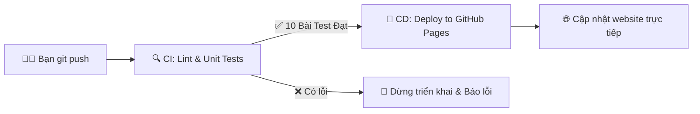

# Antenna ML Inverse Design & Digital Twin Studio 📡

[](https://github.com/Hoang-PM-7604119/antentest/actions/workflows/ci-cd.yml)
[](https://hoang-pm-7604119.github.io/antentest/)

Trang web tĩnh chạy hoàn toàn trên trình duyệt (Client-side Machine Learning) phục vụ bài toán thiết kế ngược (Inverse Design) ăng-ten từ dữ liệu mô phỏng điện từ `data1.xlsx`.

🔗 **Live Website**: **[https://hoang-pm-7604119.github.io/antentest/](https://hoang-pm-7604119.github.io/antentest/)**  
📂 **GitHub Repository**: **[https://github.com/Hoang-PM-7604119/antentest](https://github.com/Hoang-PM-7604119/antentest)**

---

## ⚡ Tự Động Hóa CI/CD: "Chỉ Cần Git Push Là Xong"

Dự án đã được tích hợp toàn diện quy trình **CI/CD tự động** thông qua GitHub Actions (`.github/workflows/ci-cd.yml`):



### 1. Quy trình CI (Continuous Integration):
Mỗi lần có lệnh `git push`, hệ thống tự động:
- Kiểm tra tính đúng đắn của toàn bộ cú pháp JavaScript và HTML.
- Chạy **10 bài kiểm thử đơn vị tự động (Unit Tests)** trong file `tests/model_test.js`:
  1. Kiểm tra tính toàn vẹn của file dữ liệu mô hình `all_models.json`.
  2. Xác thực 5 mô hình ML có đầy đủ trọng số và chỉ số MAE, $R^2$.
  3. Kiểm tra mạng nơ-ron Digital Twin Forward Simulator.
  4. Xác thực cơ sở dữ liệu mẫu mô phỏng cho KNN.
  5. Test suy luận Hồi quy Tuyến tính với các ca biên cực hạn.
  6. Test suy luận Hồi quy Đa thức bậc 2.
  7. Test thuật toán duyệt Cây Quyết định (Decision Tree).
  8. Test lan truyền tiến mạng nơ-ron (MLP Neural Network).
  9. Test kiểm tra ngược với bộ mô phỏng Digital Twin Simulator.
  10. Xác thực tính nhất quán của file nạp trình duyệt `models_data.js`.

### 2. Quy trình CD (Continuous Deployment):
- Chỉ khi tất cả các bài test trong bước CI đạt chuẩn 100%, hệ thống mới tự động đóng gói và đẩy phiên bản mới nhất lên **GitHub Pages**.
- Toàn bộ quá trình diễn ra tự động trong khoảng 30 - 45 giây.

---

## 🌟 Giới Thiệu Bài Toán & Dữ Liệu

Từ bộ dữ liệu quét tham số mô phỏng gồm **614,656 cấu hình ăng-ten**:
- **4 thông số đầu ra (Cột 1, 2, 3, 4)**: Các kích thước hình học hình học ăng-ten $d_1, d_2, d_3, d_4 \in [5, 140]\text{ mm}$ với bước quét chế tạo là $5\text{ mm}$ ($28 \times 28 \times 28 \times 28 = 614,656$ mẫu).
- **2 thông số đầu vào (Cột 5, 6)**: Các thông số đặc tính điện từ mong muốn (ví dụ Hệ số phản xạ $S_{11}$ / Return Loss và Gain / Tham số bức xạ $S_{21}$ tính bằng dB).

Mục tiêu: **Nhập 2 thông số mục tiêu (Cột 5 & 6) $\to$ Dự đoán tự động 4 kích thước hình học tối ưu (Cột 1, 2, 3, 4).**

---

## 🤖 Các Thuật Toán Học Máy (Machine Learning Models)

Hệ thống tích hợp **6 mô hình học máy từ đơn giản đến nâng cao**:

1. **Hồi quy Tuyến tính (Linear Regression)**:
   - Mô hình giải tích đơn giản nhất: $\mathbf{d} = \mathbf{W}\mathbf{v} + \mathbf{b}$. Tốc độ tính toán siêu nhanh ($< 0.01\text{ ms}$).
2. **Hồi quy Ridge (L2 Regularization)**:
   - Hồi quy tuyến tính có hiệu chỉnh $L_2$ để kiểm soát độ lệch và chống đa cộng tuyến.
3. **Hồi quy Đa thức bậc 2 (Polynomial Regression)**:
   - Bổ sung các số hạng phi tuyến bậc thấp ($v_1^2, v_2^2, v_1 v_2$) để mô tả độ uốn của bề mặt đáp ứng.
4. **Cây Quyết định (Decision Tree Regressor)**:
   - Phân đoạn không gian mục tiêu thành các khối hộp nhị phân tối ưu theo tiêu chuẩn giảm phương sai (MSE).
5. **Mạng Nơ-ron Nhân tạo (Multi-Layer Perceptron - MLP)**:
   - Mạng Deep Feedforward 3 tầng ẩn ($64 \to 64 \to 32$ nơ-ron) với hàm kích hoạt ReLU, có khả năng học các mối quan hệ phi tuyến phức tạp nhất.
6. **K Láng Giềng Gần Nhất (K-Nearest Neighbors - KNN / Database Matching)**:
   - Tìm kiếm trực tiếp các cấu hình mô phỏng thực tế gần nhất trong tập 614,656 mẫu, đảm bảo cấu hình đã qua kiểm chứng mô phỏng thực nghiệm.

---

## 🔬 Bộ Mô Phỏng Digital Twin Kiểm Tra Ngược (Forward Verification)

Ngoài mô hình nghịch đảo, hệ thống còn trang bị **Mạng Nơ-ron Digital Twin Simulator (Độ chính xác $R^2 = 91.2\%$)**:
- Nhận 4 kích thước dự đoán $d_1, d_2, d_3, d_4$.
- Mô phỏng xuôi để tính ra đáp ứng điện từ thực tế $\hat{v}_1, \hat{v}_2$.
- Tính sai số tuyệt đối $|\Delta v_1|, |\Delta v_2|$ để kỹ sư biết ngay mức độ tin cậy của thiết kế.

---

## 📁 Cấu Trúc Mã Nguồn

```text
/Users/MAC/antentest/
├── .github/workflows/
│   └── ci-cd.yml        # Pipeline CI/CD tự động (Test & Deploy GitHub Pages)
├── tests/
│   └── model_test.js    # Bộ 10 bài test tự động cho các mô hình ML
├── index.html           # Giao diện chính Responsive, trực quan hóa CAD
├── styles.css           # Bảng màu, theme Sáng/Tối, CSS Grid & Flexbox
├── app.js               # Logic suy luận 6 thuật toán ML trên trình duyệt
├── models_data.js       # Trọng số pre-trained của 6 mô hình ML & dữ liệu mẫu
├── all_models.json      # File JSON cấu trúc mô hình
├── package.json         # Cấu hình kiểm thử (npm test)
├── .gitignore           # Bỏ qua file Excel 30MB để repo nhẹ & chuẩn GitHub Pages
└── README.md            # Tài liệu dự án & CI/CD
```
