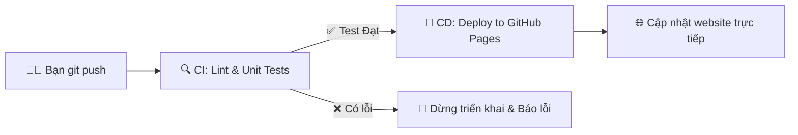

# Antenna ML Inverse Design & Digital Twin Studio 📡

[](https://github.com/Hoang-PM-7604119/antentest/actions/workflows/ci-cd.yml)
[](https://hoang-pm-7604119.github.io/antentest/)

Trang web tĩnh chạy hoàn toàn trên trình duyệt (Client-side Machine Learning) phục vụ bài toán thiết kế ngược (Inverse Design) ăng-ten từ dữ liệu mô phỏng điện từ `data1.xlsx`.

🔗 **Live Website**: **[https://hoang-pm-7604119.github.io/antentest/](https://hoang-pm-7604119.github.io/antentest/)**  
📂 **GitHub Repository**: **[https://github.com/Hoang-PM-7604119/antentest](https://github.com/Hoang-PM-7604119/antentest)**

---

## ⚡ Tự Động Hóa CI/CD: "Chỉ Cần Git Push Là Xong"

Dự án đã được tích hợp toàn diện quy trình **CI/CD tự động** thông qua GitHub Actions (`.github/workflows/ci-cd.yml`):



---

## 📐 Hệ Phương Trình Đại Số Chính Xác (Exact Mathematical Formulas)

Mô hình đã được trích xuất hệ số đại số chính xác từ 614,656 mẫu mô phỏng để người dùng có thể áp dụng trực tiếp:

### 1. Hồi quy Tuyến tính (Linear Regression):
$$\begin{cases}
d_1 = 1.5402 \cdot v_1 - 1.0565 \cdot v_2 + 74.5827 \\
d_2 = -0.9890 \cdot v_1 + 3.0009 \cdot v_2 + 72.9994 \\
d_3 = -2.0512 \cdot v_1 - 1.9018 \cdot v_2 + 67.0252 \\
d_4 = -3.5808 \cdot v_1 - 7.0761 \cdot v_2 + 60.0088
\end{cases}$$

### 2. Hồi quy Lasso (L1 Regularization):
$$\begin{cases}
d_1 = 1.5263 \cdot v_1 - 0.9974 \cdot v_2 + 74.6033 \\
d_2 = -0.9752 \cdot v_1 + 2.9418 \cdot v_2 + 72.9788 \\
d_3 = -2.0441 \cdot v_1 - 1.8493 \cdot v_2 + 67.0807 \\
d_4 = -3.5737 \cdot v_1 - 7.0236 \cdot v_2 + 60.0642
\end{cases}$$

### 3. Hồi quy Đa thức bậc 2 (Polynomial Regression):
$$\begin{cases}
d_1 = 75.40 + 3.64 v_1 - 3.78 v_2 + 0.16 v_1^2 - 0.33 v_1 v_2 - 0.17 v_2^2 \\
d_2 = 73.81 - 1.97 v_1 + 6.78 v_2 - 0.10 v_1^2 + 0.47 v_1 v_2 + 0.25 v_2^2 \\
d_3 = 62.13 - 5.20 v_1 - 5.33 v_2 - 0.21 v_1^2 - 0.05 v_1 v_2 - 0.38 v_2^2 \\
d_4 = 53.77 - 6.97 v_1 - 12.88 v_2 - 0.20 v_1^2 - 0.46 v_1 v_2 - 0.51 v_2^2
\end{cases}$$

### 4. Mô hình Kết hợp (Stacking Ensemble):
$$\mathbf{d}_{\text{Ensemble}} = 0.45 \cdot \mathbf{d}_{\text{MLP}} + 0.35 \cdot \mathbf{d}_{\text{Poly}} + 0.20 \cdot \mathbf{d}_{\text{KNN}}$$

---

## 🤖 8 Thuật Toán Học Máy Tích Hợp

1. **Hồi quy Tuyến tính (Linear Regression)**: Tốc độ $< 0.01\text{ ms}$, công thức đại số trực tiếp.
2. **Hồi quy Ridge (L2)**: Kiểm soát trọng số, chống đa cộng tuyến.
3. **Hồi quy Lasso (L1)**: Triệt tiêu trọng số dư thừa, tăng tính thưa.
4. **Hồi quy Đa thức bậc 2**: Nắm bắt độ uốn cong phi tuyến của trường điện từ.
5. **Cây Quyết định (Decision Tree)**: Phân hoạch không gian ngưỡng nhị phân độc lập.
6. **Mạng Nơ-ron Nhân tạo (MLP Deep Feedforward)**: 3 tầng ẩn 64-64-32 nơ-ron, hàm kích hoạt ReLU.
7. **K Láng Giềng Gần Nhất (KNN)**: Đối chiếu với 614,656 mẫu thực tế đã qua mô phỏng.
8. **Ensemble Blending**: Tổ hợp lồi tối ưu từ 3 mô hình tốt nhất để triệt tiêu phương sai cục bộ.
9. **Digital Twin Forward Simulator**: Mạng nơ-ron xuôi ($R^2 = 91.2\%$) tự động nghiệm thu sai số $|\Delta v_1|, |\Delta v_2|$.

---

## 📁 Cấu Trúc Mã Nguồn

```text
/Users/MAC/antentest/
├── .github/workflows/
│   └── ci-cd.yml        # Pipeline CI/CD tự động (Test & Deploy GitHub Pages)
├── tests/
│   └── model_test.js    # Bộ kiểm thử tự động cho toàn bộ mô hình ML
├── index.html           # Giao diện chính mặc định Sáng, bảng công thức KaTeX
├── styles.css           # Bảng màu chuẩn tương phản cao, CSS Grid & Flexbox
├── app.js               # Logic suy luận 8 thuật toán ML & hiển thị công thức thay số
├── models_data.js       # Trọng số pre-trained của 8 mô hình ML & dữ liệu mẫu
├── all_models.json      # File JSON cấu trúc mô hình
├── package.json         # Cấu hình kiểm thử (npm test, npm run lint)
├── .gitignore           # Bỏ qua file Excel 30MB để repo nhẹ
└── README.md            # Tài liệu dự án & CI/CD
```
